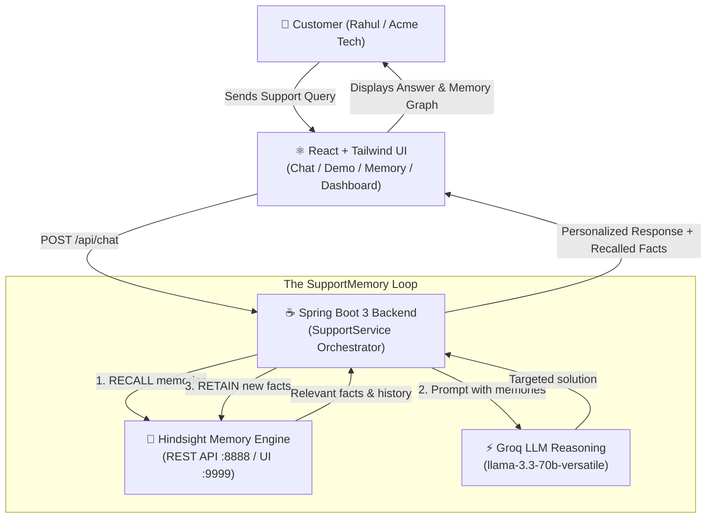

# SupportMemory AI

> **"An AI support agent that doesn't start from zero every time."**

SupportMemory AI is an intelligent customer support prototype built for the **Hindsight Agent Memory Challenge**. Traditional support bots treat every incoming message as if it were Day 1, repeatedly asking customers for their account details, plan, tech stack, and previously attempted fixes. 

**SupportMemory AI places Hindsight™ at the core of the support interaction lifecycle**:
1. **RECALL**: On message arrival, retrieves rich, structured memories, entity relationships, and historical troubleshooting outcomes.
2. **REASON**: Injects remembered context into Groq's high-speed LLM to produce targeted, zero-repetition answers.
3. **RETAIN**: Extracts and saves new operational facts, root causes, and resolutions back into Hindsight.

---

## 🏛️ System Architecture



---

## 🎭 The 4-Step Demo Story (Rahul / Acme Technologies)

The application includes an interactive **Demo Walkthrough** (`/demo`) showing side-by-side responses **Without Memory** vs. **With Hindsight**:

| Step | Customer Interaction | Without Memory (Generic Bot) | With Hindsight (SupportMemory AI) |
|---|---|---|---|
| **1. Intro** | *"My name is Rahul. I work at Acme Technologies (20 employees, Pro plan). Our Google Calendar integration isn't working."* | Welcomes generically, asks standard questions. | Welcomes Rahul, logs profile into Hindsight, gives initial troubleshooting. |
| **2. Follow-up** | *"My Google Calendar is still not working."* | *"Who are you? What plan? What calendar app?"* | Remembers Rahul, Acme Technologies, Pro plan, and previous setup. Suggests token checks. |
| **3. Learning** | *"The previous solution didn't work. The actual problem was OAuth permissions."* | Acknowledges message in isolation. | **Retains root cause**: *"OAuth permissions were the actual root cause for Acme Technologies' Google Calendar integration."* |
| **4. The Payoff** | *"My calendar is broken again."* | *"What calendar are you using? Can you explain the error?"* | **Immediately identifies the root cause**: *"Hi Rahul! I remember your Google Calendar issue at Acme Technologies. Last time, the root cause was OAuth permissions rather than a sync fault. Let's check your OAuth token scopes first!"* |

---

## 🧠 Hindsight Integration Details

SupportMemory AI directly interfaces with the official Hindsight REST API:

- **Retain (`POST /v1/banks/{bank_id}/retain`)**:
  ```json
  {
    "content": "OAuth permissions were identified as the root cause of the Google Calendar issue",
    "context": "Customer Rahul is speaking to the support agent"
  }
  ```
  *The `context` parameter differentiates customer statements (`world` facts) from agent responses (`experience` facts).*

- **Recall (`POST /v1/banks/{bank_id}/recall`)**:
  ```json
  {
    "query": "My calendar is broken again.",
    "max_tokens": 4096,
    "budget": "mid",
    "types": ["world", "experience", "observation"]
  }
  ```
  *Leverages Hindsight's multi-strategy search (Semantic, Keyword, Knowledge Graph, Temporal) to surface past resolutions.*

- **Resilient Fallback Mode**: If the local Docker Hindsight container is offline during quick evaluation, the backend activates a built-in memory mirror following the identical schema (`world`, `experience`, entities, scoring), guaranteeing seamless execution.

---

## ⚡ Tech Stack

- **Frontend**: React 19, Vite, Tailwind CSS v4, Lucide React, React Router 7
- **Backend**: Spring Boot 3.3.5, Java 17/24, Gradle 8.14, Spring Data JPA, WebFlux (WebClient)
- **Database**: H2 (In-memory/file development) / MySQL compatible
- **LLM Provider**: Groq API (`llama-3.3-70b-versatile` / OpenAI-compatible endpoint)
- **Memory Provider**: Hindsight™ by Vectorize.io (REST API on port 8888, UI on 9999)

---

## 🚀 Quick Start Guide

### 1. Prerequisites
- **Java**: JDK 17 or higher (tested with JDK 24)
- **Node.js**: v18+ (tested with Node v22)
- **Docker** (Optional, for live Hindsight container)

### 2. Start Hindsight (Optional - Docker)
```bash
docker compose up -d
```
*Hindsight REST API will be available at `http://localhost:8888` and Web UI at `http://localhost:9999`.*

### 3. Start the Spring Boot Backend
```bash
cd backend
./gradlew bootRun
```
*The backend starts at `http://localhost:8080`. Baseline demo data and customers are automatically seeded on startup.*

### 4. Start the React Frontend
```bash
cd frontend
npm install
npm run dev
```
*Open `http://localhost:5173/` in your browser.*

---

## 🗺️ Application Routes

- `/` — **Dashboard**: High-level metrics on retained facts, recalled memories, and live activity stream.
- `/chat` — **Live Chat Experience**: Interactive support chat with real-time memory recall inspection panel.
- `/demo` — **Before vs. After Demonstration**: 4-step interactive comparison showing how memory transforms support quality.
- `/memory` — **Memory Explorer**: Deep dive into customer memory banks, fact classifications (`world`, `experience`, `observation`), and entity tags.
- `/customers` — **Customer Directory**: Manage customer profiles and technical context.

---

## 📡 REST API Reference

| Method | Endpoint | Description |
|---|---|---|
| `POST` | `/api/chat` | Send customer message (`{ customerId, message, useMemory }`) |
| `GET` | `/api/memory/recall` | Retrieve recalled memories for customer |
| `GET` | `/api/memory/events` | List historical retain and recall audit events |
| `GET` | `/api/dashboard/stats` | Summary statistics for customers, conversations, and memories |
| `POST` | `/api/demo/reset` | Resets demo state and seeds fresh baseline memories for Rahul |
| `GET` | `/api/customers` | List all registered customers |
| `GET` | `/api/health` | Health check reporting backend, Hindsight, and Groq status |

---

## 🛡️ License
Built for the **Hindsight Hackathon Challenge**.
