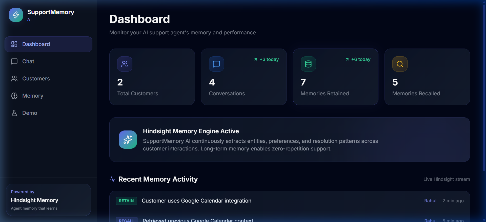
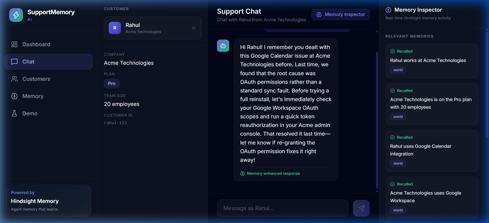
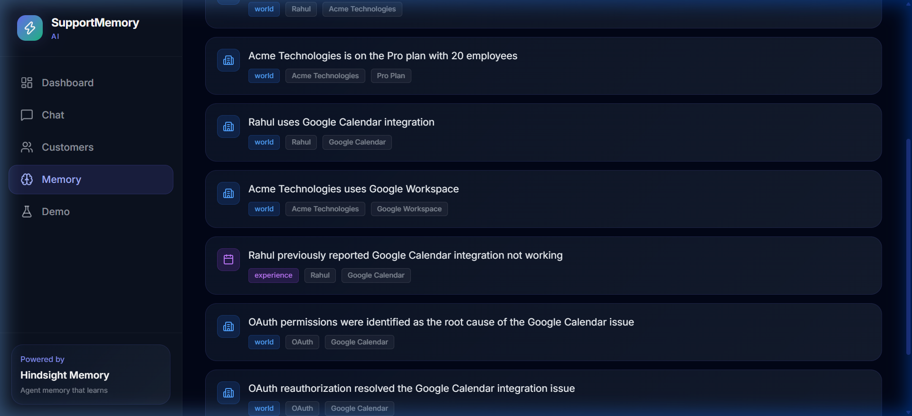
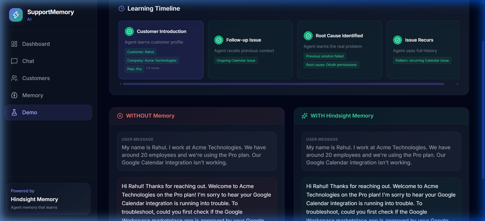
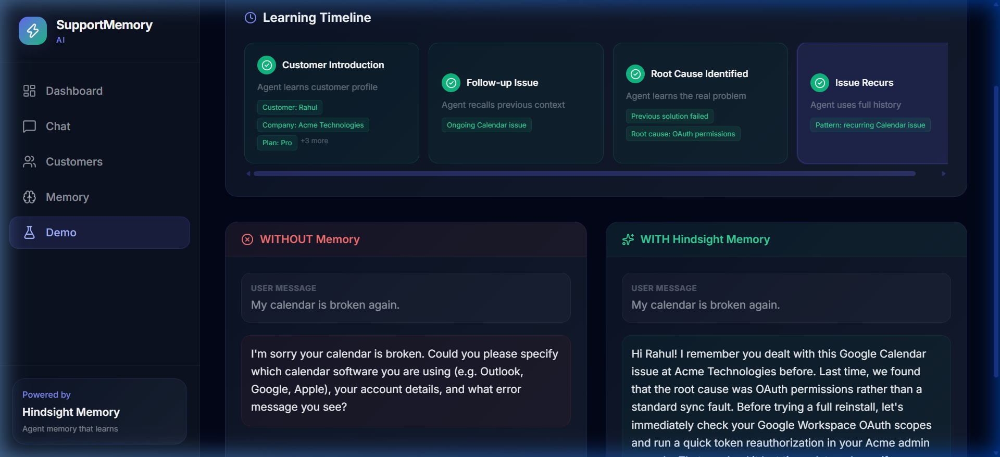

# SupportMemory AI

## Tagline

> **"An AI support agent that doesn't start from zero every time."**

---

## 1. Overview

**SupportMemory AI** is an intelligent, context-aware customer support platform powered by **Hindsight** memory engine and **Groq** high-speed LLM inference. 

### The Problem
Traditional customer support agents—both human and AI bots—are fundamentally stateless across sessions. When a customer reaches out days or weeks later with a recurring issue, they are forced to repeat themselves: their company name, subscription tier, environment details, and what troubleshooting steps were already tried. This repetitive friction degrades customer satisfaction and increases resolution times.

### The Solution
SupportMemory AI integrates **Hindsight** as an autonomous long-term cognitive memory layer. After every customer interaction, key operational facts and troubleshooting outcomes are retained into the customer's dedicated memory bank. When the customer returns, relevant past context is recalled and synthesized into the LLM system prompt before generating an answer. SupportMemory AI transforms support from repetitive interrogation into personalized, proactive resolution.

---

## 2. Key Idea

SupportMemory AI is designed around a clear separation of concerns between reasoning, memory, orchestration, and presentation:

- **Hindsight = Long-Term Agent Memory**: Autonomous memory engine managing entity extraction, knowledge graph relations, world facts, and experience memories. Hindsight enables zero-repetition support.
- **Groq = Ultra-Fast LLM Generation**: Powered by `llama-3.3-70b-versatile`, Groq delivers sub-second inference speeds, synthesizing recalled memory into concise, actionable support guidance without conversational lag.
- **Spring Boot = Backend & Memory Orchestration**: Robust enterprise Java backend orchestrating the dual Recall-and-Retain lifecycle, handling session isolation, audit logs, and REST APIs.
- **React = Frontend Presentation**: Modern dark-themed dashboard, real-time chat with a live Memory Inspector, and an interactive Before vs. After learning timeline.

---

## 3. Features

- **AI Customer Support Chat**: Fast, context-augmented support chat powered by Groq and Spring Boot.
- **Persistent Customer Memory**: Hindsight memory banks maintain long-term memory across sessions and restarts.
- **Memory Recall**: Real-time contextual recall (`/v1/banks/{id}/recall`) matching incoming queries against past world facts and experience history.
- **Memory Retention**: Autonomous retention (`/v1/banks/{id}/retain`) capturing customer facts, environment configurations, and resolution outcomes.
- **Customer Context Panel**: Live customer overview displaying name, company, subscription tier, team size, and customer ID.
- **Troubleshooting History**: Tracks past issue reports, diagnostic attempts, and identified root causes.
- **Real-Time Memory Inspector**: Live sidebar during chat showcasing recalled facts, memory types (`world` vs `experience`), and confidence scores.
- **Learning Timeline**: Visual 4-step progressive timeline demonstrating how the agent accumulates knowledge step by step.
- **Before vs. After Demonstration**: Side-by-side comparison illustrating generic bot behavior (without memory) versus personalized agent behavior (with Hindsight).
- **Clean Demo Reset**: One-click demo reset that cleans memory banks via live Hindsight bank deletion (`DELETE /v1/banks/{bank_id}`) and initializes isolated sessions for repeatable judging.

---

## 4. Architecture

### System Architecture Diagram


### High-Level Interaction Flow

```
Customer Message
       ↓
React Frontend (Vite + Tailwind CSS)
       ↓
Spring Boot Backend (REST Orchestrator)
       ↓
Hindsight Recall (/v1/banks/{bank_id}/recall)
       ↓
Relevant Memories (World & Experience Facts)
       ↓
Groq Cloud LLM (llama-3.3-70b-versatile with Injected Context)
       ↓
AI Response Generated
       ↓
Hindsight Retain (/v1/banks/{bank_id}/retain)
       ↓
Targeted Response Returned to Customer
```

For full architecture specifications, see [docs/architecture.md](docs/architecture.md).

---

## 5. How Hindsight Is Used

Hindsight is the foundational memory layer of SupportMemory AI. Rather than querying an arbitrary vector database with raw embeddings, Hindsight manages structured **World facts** (customer entity data, plans, tech stack) and **Experience facts** (previous tickets, troubleshooting steps, and confirmed root causes).

### The 6-Step Lifecycle

1. **Customer Sends a Message**: The user sends an inquiry through the React chat interface.
2. **Backend Retrieves Relevant Memory**: `HindsightService` executes a semantic recall query against the customer's isolated Hindsight bank (`/v1/banks/{bank_id}/recall`).
3. **Context Injection**: Recalled memories are structured and injected into the LLM system prompt.
4. **Groq Generates Response**: Groq receives both the customer message and the historical context, formulating a response that avoids repetitive questions.
5. **Useful Information Retained**: Immediately following generation, `HindsightService` extracts new facts and retains them in Hindsight (`/v1/banks/{bank_id}/retain`).
6. **Future Conversations Benefit**: When the customer reaches out later, previous troubleshooting steps and root causes are immediately available.

### Real Code Snippets from `HindsightService.java`

#### Memory Recall Query:
```java
public List<MemoryItem> recall(String customerId, String query) {
    String bankId = getBankId(customerId);
    HindsightRecallRequest req = new HindsightRecallRequest(
        query, 
        4096, 
        "mid", 
        List.of("world", "experience", "observation")
    );
    String payload = objectMapper.writeValueAsString(req);

    String response = webClient.post()
            .uri(baseUrl + "/v1/banks/" + bankId + "/recall")
            .header("Content-Type", "application/json")
            .bodyValue(payload)
            .retrieve()
            .bodyToMono(String.class)
            .timeout(Duration.ofSeconds(3))
            .block();
    // Parse memories and return structured MemoryItem list...
}
```

#### Memory Retention:
```java
public MemoryItem retain(String customerId, String content, String context) {
    String bankId = getBankId(customerId);
    HindsightRetainRequest req = new HindsightRetainRequest(content, context);
    String payload = objectMapper.writeValueAsString(req);

    String response = webClient.post()
            .uri(baseUrl + "/v1/banks/" + bankId + "/retain")
            .header("Content-Type", "application/json")
            .bodyValue(payload)
            .retrieve()
            .bodyToMono(String.class)
            .timeout(Duration.ofSeconds(3))
            .block();
    // Persist memory item & log audit event...
}
```

---

## 6. Groq / LLM Integration

### Model Configuration
- **Model**: `llama-3.3-70b-versatile`
- **Provider**: Groq Cloud (`https://api.groq.com/openai/v1/chat/completions`)
- **Parameters**: `temperature: 0.7`, `max_tokens: 1024`

### Why Groq?
Support chatbots demand instantaneous response times. Groq's LPU inference engine delivers sub-second token generation speeds, ensuring that recalling and injecting memory does not introduce latency into the customer support experience.

### Context Injection Pattern
Recalled memories are formatted into the system prompt:
```text
You are SupportMemory AI, a proactive, context-aware AI customer support agent.
Customer: Rahul, Company: Acme Technologies, Plan: Pro, Team Size: 20.

--- RECALLED CUSTOMER MEMORIES (FROM HINDSIGHT) ---
• [world] Acme Technologies is on the Pro plan with 20 employees
• [world] Rahul uses Google Calendar integration
• [world] Acme Technologies uses Google Workspace
• [experience] Rahul previously reported Google Calendar integration not working
• [world] OAuth permissions were identified as the root cause of the Google Calendar issue
• [world] OAuth reauthorization resolved the Google Calendar integration issue
---------------------------------------------------
INSTRUCTIONS:
1. Acknowledge and utilize the recalled memories directly.
2. Do NOT ask the customer to repeat information that is already in memory.
3. If previous troubleshooting or root cause was recorded, build immediately upon it.
4. Provide targeted, personalized, and efficient troubleshooting.
```

---

## 7. Demo Scenario: Rahul & Acme Technologies

The project features a complete multi-step support journey demonstrating memory accumulation:

1. **Step 1 — Customer Introduction**:
   - Rahul introduces himself: *"My name is Rahul. I work at Acme Technologies. We have around 20 employees and we're using the Pro plan. Our Google Calendar integration isn't working."*
   - Hindsight retains company name, tier, seat count, and integration choice.
2. **Step 2 — Follow-up Issue**:
   - Rahul asks for a status update. The agent recalls his profile and Google Calendar context without re-asking his credentials.
3. **Step 3 — Root Cause Identified**:
   - Diagnostic investigation reveals the problem was caused by Google Workspace OAuth permission expiration.
   - Hindsight retains the root cause and successful reauthorization solution.
4. **Step 4 — Issue Recurs**:
   - Rahul returns later: *"My calendar is broken again."*
   - Rather than asking *"Which calendar provider do you use?"*, the agent immediately recalls the prior OAuth issue and advises checking Google Workspace admin OAuth scopes.

---

## 8. Before vs After Hindsight

| Criteria | ❌ WITHOUT Memory (Standard Bot) | ✅ WITH Hindsight (SupportMemory AI) |
|---|---|---|
| **First Question** | *"What calendar software are you using? What plan are you on?"* | *"Hi Rahul! I remember you dealt with this Google Calendar issue at Acme Technologies before."* |
| **Context Retention** | Forgets company size, plan tier, and previous solutions. | Remembers Pro plan, 20 employees, and past troubleshooting. |
| **Troubleshooting Speed** | Suggests basic repetitive steps (reinstall app, verify internet). | Skips standard diagnostics; goes straight to known root cause (OAuth scopes). |
| **Customer Friction** | High repetition, slow time to resolution. | Zero repetition, immediate personalized support. |

---

## 9. Tech Stack

### Frontend
- **Framework**: React 19 (SPA)
- **Build Tool**: Vite 6
- **Styling**: Tailwind CSS 4
- **Routing**: React Router DOM 7
- **Icons**: Lucide React

### Backend
- **Runtime**: Java 17+ (Compiled & validated on Java 24)
- **Framework**: Spring Boot 3.3.5
- **Web Client**: Spring WebFlux (`WebClient`)
- **Persistence**: Spring Data JPA with H2 in-memory/file database
- **Build Tool**: Gradle 8.14 (with Gradle Wrapper)

### Cognitive & AI Services
- **Memory Engine**: [Hindsight](https://github.com/vectorize-io/hindsight) (REST API on port `8888`)
- **LLM Provider**: Groq Cloud API (`llama-3.3-70b-versatile`)

---

## 10. Project Structure

```
support-memory-ai/
├── backend/
│   ├── build.gradle
│   ├── gradlew / gradlew.bat
│   └── src/
│       ├── main/
│       │   ├── java/com/supportmemory/
│       │   │   ├── SupportMemoryAiApplication.java
│       │   │   ├── controller/
│       │   │   │   ├── ChatController.java
│       │   │   │   ├── ConversationController.java
│       │   │   │   ├── CustomerController.java
│       │   │   │   ├── DashboardController.java
│       │   │   │   ├── DemoController.java
│       │   │   │   ├── HealthController.java
│       │   │   │   └── MemoryController.java
│       │   │   ├── dto/
│       │   │   ├── model/
│       │   │   ├── repository/
│       │   │   └── service/
│       │   │       ├── GroqLLMService.java
│       │   │       ├── HindsightService.java
│       │   │       ├── LLMService.java
│       │   │       └── SupportService.java
│       │   └── resources/
│       │       └── application.properties
│       └── test/
├── frontend/
│   ├── index.html
│   ├── package.json
│   ├── vite.config.js
│   └── src/
│       ├── App.jsx
│       ├── components/
│       │   ├── Layout.jsx
│       │   └── Navbar.jsx
│       └── pages/
│           ├── Chat.jsx
│           ├── Customers.jsx
│           ├── Dashboard.jsx
│           ├── Demo.jsx
│           └── Memory.jsx
├── docs/
│   ├── architecture.md
│   ├── architecture.svg
│   └── images/
│       ├── 01-dashboard.png
│       ├── 02-chat.png
│       ├── 03-memory.png
│       ├── 04-demo.png
│       └── 05-before-after.png
├── .env.example
├── .gitignore
└── README.md
```

---

## 11. Prerequisites

Before running the project locally, ensure you have:

- **Java**: JDK 17 or higher (tested with Java 24)
- **Node.js**: v18.0.0 or higher (tested with Node v20+)
- **npm**: v9.0.0 or higher
- **Groq API Key**: Obtain a free API key at [console.groq.com](https://console.groq.com)
- **Hindsight Server**: Run locally via Docker or Python (`http://localhost:8888`)

---

## 12. Environment Variables

Create a `.env` file in the root directory by copying `.env.example`:

```bash
cp .env.example .env
```

### Required Configuration in `.env`:
```env
# Groq LLM API Configuration
GROQ_API_KEY=your_groq_api_key_here
GROQ_MODEL=llama-3.3-70b-versatile

# Hindsight Memory Engine Configuration
HINDSIGHT_BASE_URL=http://localhost:8888
HINDSIGHT_API_KEY=your_hindsight_api_key_here
```

> **Security Notice**: Never commit `.env` files with actual API keys to GitHub. Git ignores `.env` by default via `.gitignore`.

---

## 13. Installation

### 1. Clone the Repository
```bash
git clone https://github.com/akshaymacharla/SupportMemory-AI.git
cd SupportMemory-AI
```

### 2. Install Frontend Dependencies
```bash
cd frontend
npm install
cd ..
```

### 3. Build Backend
```bash
cd backend
./gradlew build -x test
cd ..
```
*(On Windows PowerShell, use `.\gradlew.bat build -x test`)*

---

## 14. Running the Application

### 1. Start Hindsight (Memory Engine)
If running Hindsight locally:
```bash
docker run -p 8888:8888 vectorize/hindsight
```
*Note: If Hindsight is not running, the application smoothly utilizes its built-in local memory fallback store.*

### 2. Start Backend (Spring Boot)
```bash
cd backend
./gradlew bootRun
```
The backend starts at `http://localhost:8080`.

### 3. Start Frontend (React + Vite)
```bash
cd frontend
npm run dev
```
The frontend starts at `http://localhost:5173`.

---

## 15. Demo Instructions

To experience SupportMemory AI's memory capabilities:

1. Open `http://localhost:5173/demo` in your browser.
2. Click **Reset Demo** to purge any previous memory bank state and ensure an isolated test environment.
3. Click **Step 1: Customer Introduction** — observe Rahul introduce himself and Acme Technologies.
4. Click **Step 2: Follow-up Issue** — note that the agent recalls his company context.
5. Click **Step 3: Root Cause Identified** — the agent identifies Google Workspace OAuth permissions as the issue.
6. Click **Step 4: Issue Recurs** — observe the **Before vs. After** comparison:
   - **WITHOUT Memory**: Asks generic questions from scratch.
   - **WITH Hindsight**: Immediately references the Pro plan and previously resolved OAuth permissions.
7. Navigate to the **Memory** page (`/memory`) or the **Chat** page (`/chat`) to inspect recalled entities and memory events in real-time.

---

## 16. API Endpoints

| Method | Endpoint | Description | Request Body | Response |
|---|---|---|---|---|
| `POST` | `/api/chat` | Send a customer message; executes recall, LLM generation, and memory retention | `{ customerId, message, useMemory, demoSessionId }` | `ChatResponse` (message, recalledMemories, retainedMemory) |
| `GET` | `/api/customers` | Retrieve all customer profiles | None | List of `Customer` objects |
| `GET` | `/api/customers/{id}` | Retrieve specific customer profile | None | `Customer` object |
| `POST` | `/api/customers` | Register or update customer profile | `Customer` JSON | Created `Customer` object |
| `GET` | `/api/conversations` | Retrieve recent conversations | `?customerId={id}` (optional) | List of `Conversation` objects |
| `GET` | `/api/conversations/{id}` | Get messages for a conversation | None | List of `Message` objects |
| `GET` | `/api/dashboard/stats` | Retrieve platform-wide metrics | None | `DashboardStats` (counts for customers, retain, recall) |
| `GET` | `/api/memory/recall` | Retrieve all memories for a customer | `?customerId={id}` | List of `MemoryItem` objects |
| `GET` | `/api/memory/events` | Audit stream of memory operations | `?customerId={id}` (optional) | List of `MemoryEvent` objects |
| `GET` | `/api/memory/stats` | Summary counts of retain/recall ops | None | `{ totalRetained, totalRecalled, hindsightConnected }` |
| `POST` | `/api/demo/reset` | Purge demo memory banks and start fresh session | `{ demoSessionId }` (optional) | `{ status: "success", demoCustomerId }` |
| `GET` | `/api/health` | Health check endpoint | None | `{ status: "UP", hindsightConnected, llmModel }` |

---

## 17. Screenshots

### 1. Dashboard Overview

*Real-time monitoring of customer counts, conversations, retained memories, and live memory activity stream.*

### 2. Support Chat with Memory Inspector

*Interactive chat session with real-time memory sidebar showing recalled World and Experience memories.*

### 3. Memory Knowledge Store

*Persistent Hindsight memory bank displaying world facts, customer preferences, and historical resolutions.*

### 4. Interactive Demo

*Multi-stage learning timeline illustrating the agent's progressive acquisition of customer context.*

### 5. Before vs. After Hindsight Comparison

*Side-by-side contrast proving how Hindsight eliminates repetitive questions and delivers instant targeted support.*

---

## 18. Testing & Verification

The following verification steps have been executed and validated:

- **Frontend Build**: `npm run build` succeeds cleanly with 0 TypeScript/JSX compiler warnings.
- **Backend Build**: `./gradlew compileJava` and `./gradlew build -x test` compile with Java 24 compatibility.
- **Hindsight Integration**: Validated live retention (`/v1/banks/{id}/retain`), live recall (`/v1/banks/{id}/recall`), and bank deletion (`/v1/banks/{id}`).
- **Groq LLM Generation**: Validated context-augmented chat completions using `llama-3.3-70b-versatile`.
- **Demo Isolation**: Validated demo reset with session-scoped IDs (`demo-rahul-{timestamp}`) ensuring independent test runs.
- **Security Audit**: Scanned codebase for secrets, API tokens, and credentials; verified `.gitignore` excludes all `.env` and runtime data.

---

## 19. Troubleshooting

### 1. Groq API Key Not Recognized
- **Symptom**: Chat returns fallback reasoning responses.
- **Fix**: Ensure `GROQ_API_KEY` in `.env` or system environment variables is set to a valid key starting with `gsk_`.

### 2. Hindsight Server Unavailable
- **Symptom**: Backend logs `Hindsight live recall unavailable, falling back to local memory store`.
- **Fix**: Start the Hindsight service on port `8888`. Note: The application seamlessly handles this with its local persistent store for local offline testing.

### 3. Java Version Compatibility
- **Symptom**: `Unsupported class file major version` during Gradle compile.
- **Fix**: Use JDK 17, 21, or 24. Ensure `JAVA_HOME` points to your active JDK.

### 4. Frontend Cannot Connect to Backend
- **Symptom**: Network error when sending chat messages.
- **Fix**: Verify backend is running on `http://localhost:8080`. Check `GET http://localhost:8080/api/health`.

---

## 20. Future Improvements

*(Planned roadmap items — not currently in main branch)*:
- **Multi-Agent Escalation**: Dynamic handoff to specialized human or automated billing/security agents.
- **Multimodal Support**: Ingesting screenshots and log files directly into Hindsight memory.
- **CRM Sync**: Two-way synchronization with Salesforce, Zendesk, and HubSpot ticket histories.
- **Enterprise RBAC**: Role-based access controls for multi-tenant enterprise support organizations.

---

## 21. License

This project is licensed under the **MIT License** — see the [LICENSE](LICENSE) file for details.
