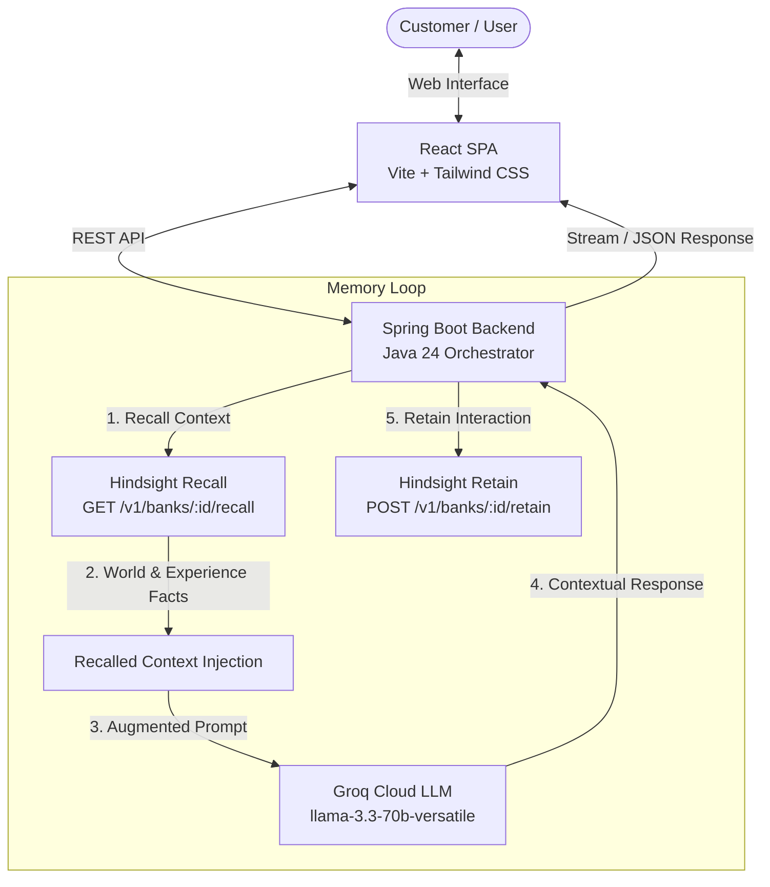

# SupportMemory AI — System Architecture

SupportMemory AI bridges ultra-fast LLM generation with persistent, agentic long-term memory. Unlike stateless chat agents that query raw vector databases, SupportMemory AI leverages **Hindsight** as an autonomous cognitive memory engine combined with **Groq** for high-speed inference.

---

## High-Level Architecture Diagram

---

## Architecture Flow

1. **User Interaction**:
   - Customer initiates or replies to a support thread in the React web frontend (`/chat` or `/demo`).
   - The React frontend emits `POST /api/chat` with `customerId`, `message`, and `demoSessionId`.

2. **Autonomous Memory Recall**:
   - The Spring Boot backend (`HindsightService`) queries Hindsight via `POST /v1/banks/{bank_id}/recall`.
   - Hindsight searches the customer's knowledge bank across both **World facts** (e.g. company size, plan, tools) and **Experience facts** (e.g. prior troubleshooting steps, root causes, past outcomes).

3. **Context Injection & Groq Inference**:
   - Recalled memories are structured into an augmented system prompt.
   - The backend dispatches the request to **Groq** using the ultra-fast `llama-3.3-70b-versatile` model.
   - The LLM receives the exact past root cause and context, generating an immediate, targeted resolution without repeating basic diagnostic questions.

4. **Continuous Learning via Memory Retain**:
   - Immediately following the response, the backend asynchronously retains the interaction in Hindsight via `POST /v1/banks/{bank_id}/retain`.
   - Hindsight continuously extracts entities, relationships, and resolution patterns into long-term memory for future conversations.

5. **Clean Session Isolation**:
   - For demo scenarios, `DemoController` manages isolated memory banks (`demo-rahul-{timestamp}`). Resetting the demo calls `DELETE /v1/banks/{bank_id}` on Hindsight, ensuring a 100% reproducible demo for judges and evaluators.
